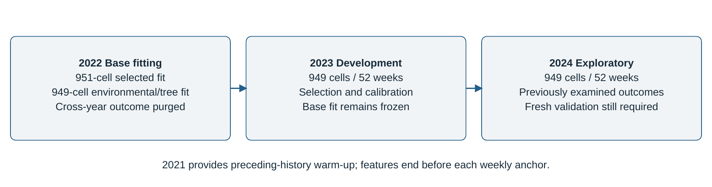
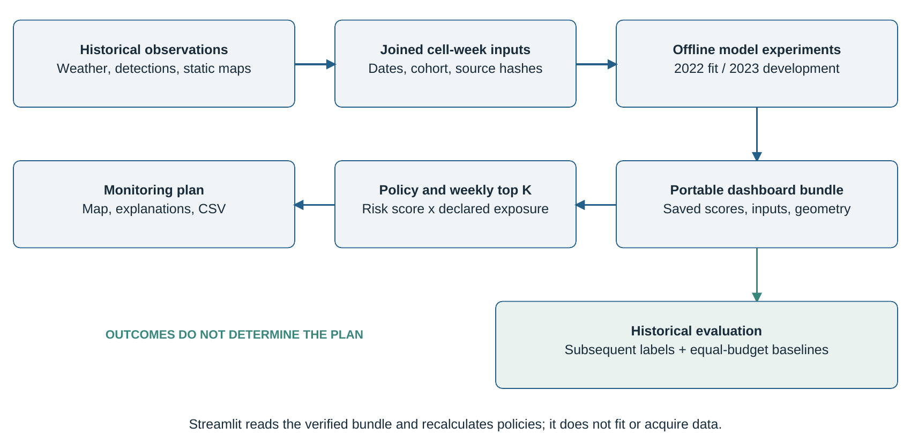
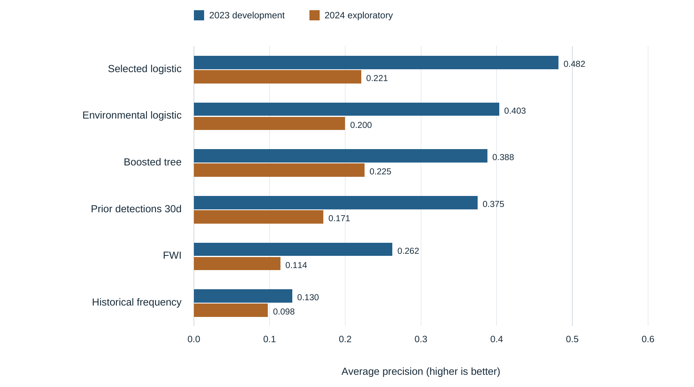
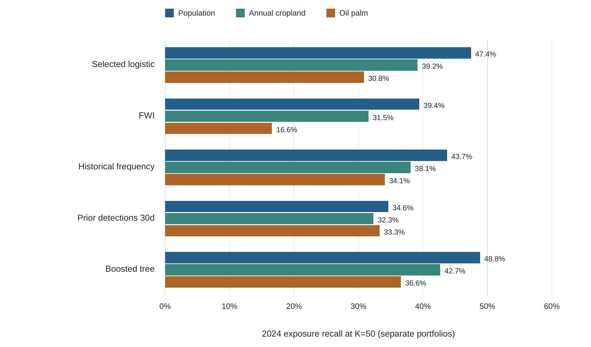

# FireGuard Project Report

**Retrospective fire occurrence modelling and preventive monitoring priorities in South Sumatra Indonesia**

**Report date:** 11 October 2026  
**Project context:** Dormathon 2026, Predictive Model Track  
**Software version:** 0.2.0  
**Study period:** 2022 to 2024, with 2021 observations providing historical feature warm-up  
**Application status:** Historical Streamlit prototype with a verified local data bundle

## Abstract

FireGuard addresses the allocation of limited preventive monitoring resources across South Sumatra, Indonesia. It combines a supervised model of subsequent satellite fire detections with mapped population and agricultural exposure to select a fixed number of decision cells each week. The system uses approximately 10 km cells, historical Copernicus fire danger indices, NASA FIRMS VIIRS S-NPP observations, WorldPop population estimates, ESA WorldCover land cover, a global oil-palm map, and PEATMAP. The source table contains 149,760 cell-week observations; the common evaluation cohort comprises 949 eligible cells. The selected logistic regression model uses eight weather, recent detection, and seasonal predictors. Its base parameters are fitted on 2022 observations, while 2023 supplies model development and sigmoid calibration. The selected model achieves average precision of 0.482 in 2023 and 0.221 in the exploratory 2024 comparison. At a budget of 50 cells per week, its risk-only ranking captures 21.5% of positive 2024 cell-weeks, compared with 21.3% for preceding 30-day detections and 6.8% for the Fire Weather Index. Separate exposure policies capture 47.4% of population exposure, 39.2% of annual-cropland exposure, and 30.8% of closed-canopy oil-palm exposure associated with positive cell-weeks. A combined policy provides explicit stakeholder weights and preserves each exposure's units in evaluation. A tested boosted-tree challenger improves some 2024 results but fails the recorded 2023 adoption rule. FireGuard demonstrates a reproducible historical planning workflow; these results do not establish live forecasting, new-ignition prediction, damage estimates, or the effectiveness of preventive interventions.

**Keywords:** fire occurrence, South Sumatra, logistic regression, remote sensing, exposure, monitoring allocation, temporal evaluation, decision support.

## Contents

1. Introduction and objectives
2. Scientific background and related work
3. Requirements and project scope
4. Study area and data preparation
5. Modelling and allocation methodology
6. Software architecture and implementation
7. Experimental results
8. Dashboard workflow and interpretation
9. Verification and quality assurance
10. Installation and reproducibility
11. Discussion and limitations
12. Future development
13. Conclusion
14. References
15. Appendices

## 1 Introduction and objectives

### 1.1 Problem statement

A forestry or peatland management officer must distribute a limited number of monitoring teams across many potential locations. A weather danger map can describe conditions favourable to fire, but it does not directly answer which locations should receive attention when exposure and resources also matter. FireGuard turns this question into a transparent weekly decision: given a budget of K equal-cost cell inspections, which cells should be selected, and what information explains their priority?

The project separates two decisions. An occurrence model ranks the likelihood of a qualifying satellite detection in a subsequent seven-day window. An allocation policy then combines that model score with the exposure of people or agricultural assets inside each cell. This separation makes it possible to change stakeholder priorities without changing the fitted occurrence model.

The implemented system supports preventive monitoring and local condition checks. Its unit of action is a grid cell during a selected historical week. Field access, travel scheduling, inspection effectiveness, and emergency response are outside the implemented decision model. [P1, P2]

### 1.2 Aim and objectives

The aim is to develop and evaluate a historical decision-support prototype that translates fire occurrence ranking into a budget-constrained monitoring plan. The project has six technical objectives:

1. Integrate fire observations, weather danger, population, and landscape measurements on a consistent spatial and temporal framework.
2. Define a supervised target with explicit observation and feature cutoffs.
3. Compare occurrence models and simple baselines using chronological development and evaluation.
4. Allocate equal-cost inspections through deterministic weekly top-K rankings.
5. Present separate and combined exposure policies with traceable explanations and fair baseline comparisons.
6. Package the results for a lightweight application and verify model exports, data integrity, and interactive controls.

### 1.3 Research questions

**RQ1:** How does a model combining past fire weather, recent detections, and seasonality compare with weather-only and historical detection baselines for subsequent detection ranking?

**RQ2:** How does multiplying a model score by exposure change the monitoring portfolio and the exposure associated with captured positive cell-weeks?

**RQ3:** Do measured environmental features and a fixed nonlinear challenger improve the recorded development criteria sufficiently to replace the simpler model?

**RQ4:** Can policy weights, data provenance, and evaluation limits be presented transparently in an interactive historical planning application?

These questions concern predictive association and allocation behaviour. The study does not estimate causal effects of inspection or intervention.

### 1.4 Contributions and evidence scope

FireGuard contributes an integrated regional dataset, a portable occurrence model, an exposure-aware allocation layer, and a working historical interface. Its contribution is the integration and evaluation of these components for a specific planning problem. The project does not introduce a new learning algorithm or claim universal superiority over established fire warning systems.

The numerical results refer to saved project artifacts and the code state audited on 11 October 2026. The documentation audit independently reconstructs dashboard scores and allocation summaries. The project sources in Appendix A identify the implementation and experiments supporting each section. Scholarly and dataset references use numbered citations; project evidence uses P-prefixed identifiers. [P1-P9]

## 2 Scientific background and related work

### 2.1 Fire danger and observed occurrence

Fire weather describes atmospheric conditions that support burning, spread, and persistence. A fire danger index is therefore useful context for occurrence modelling, but weather conditions alone do not identify every ignition or establish that damaging fire will occur. Vitolo et al. describe ERA5-derived global fire danger maps and the distinction between meteorological danger and observed fire activity. FireGuard uses retrieved historical danger indices as numerical predictors and evaluates them against satellite observations. [1]

The Canadian Fire Weather Index system includes the Fire Weather Index (FWI), Fine Fuel Moisture Code (FFMC), and Drought Code (DC). FireGuard retains rolling FWI measurements in the selected model and tests FFMC and DC in environmental candidates. These indices are measurements from the source product; the application does not calculate a physical fire spread simulation. Historical CEMS documentation identifies ERA5 as the forcing for the reconstructed fire danger series. [1, 2]

### 2.2 Regional fire prediction research

ProbFire integrates seasonal climate information, previous fire activity, peat extent, and forest information in a probabilistic warning system for Indonesia. It evaluates monthly fire activity on a 0.25-degree grid over a substantially longer record. Its findings motivate consideration of weather and environmental predictors in an Indonesian setting. [3]

FireGuard adapts this general motivation to a different task: a weekly binary VIIRS target, approximately 10 km decision cells, a three-year label dataset, and explicit monitoring budgets. The seven-day and thirty-day windows, calendar encoding, logistic regression, and policy rules are project choices. Consequently, FireGuard's results cannot be compared numerically with ProbFire as if the target, evaluation periods, and observation instruments were identical.

### 2.3 Satellite observations as labels

NASA FIRMS provides active-fire and hotspot observations, including VIIRS S-NPP detections. The archive distinguishes standard science-quality records from near-real-time observations, and NASA identifies the relevant VIIRS product as a 375 m active-fire product. [4, 5]

FireGuard treats these detections as an observable proxy for activity within a cell. Multiple records can refer to continuing burning, and several detections can belong to one event. A positive cell-week may include agricultural burning or persistent activity. Conversely, an absence of qualifying archive detections is an observed negative, not proof that a cell experienced no fire. These distinctions determine what the classifier can legitimately be said to predict.

### 2.4 Exposure and landscape information

Population counts and mapped agricultural areas describe different forms of exposure. WorldPop supplies estimated population counts on an approximately 1 km grid. ESA WorldCover 2020 supplies a 10 m land-cover product; its cropland class represents annual herbaceous cultivation, while perennial woody crops may be assigned to tree or shrub classes. [6-8]

The Descals et al. map distinguishes industrial and smallholder closed-canopy oil palm for the second half of 2019. Young or sparse palms and some heterogeneous cultivation are outside that product's coverage. PEATMAP compiles peat extent from regional and national sources; its mapped extent should not be interpreted as contemporary peat moisture or depth. [9, 10]

These sources support distinct analytical roles. Landscape fractions can describe occurrence predictors in an experiment, while people and hectares can define allocation exposure. The selected occurrence model excludes exposure, coordinates, and environmental fractions; the application still uses those data for prioritization or context.

### 2.5 Evaluation for a planning system

Average precision (AP) summarizes how well a score ranks observed positives across thresholds. The scikit-learn implementation weights precision by increments in recall and does not use trapezoidal interpolation. [11]

AP alone does not describe a resource-limited plan. FireGuard also measures precision and recall at a fixed weekly budget, and the share of exposure associated with positive cell-weeks captured by the chosen portfolio. Together, these metrics distinguish general occurrence ranking from the specific consequences of allocation.

## 3 Requirements and project scope

### 3.1 Functional requirements

*Table 1. Functional requirements and implemented behaviour.*

| ID | Requirement | Implemented evidence |
| :--- | :--- | :--- |
| FR1 | Select a historical year and week | 2023 and 2024 week controls in the application |
| FR2 | Select a monitoring budget | K slider from 1 to 200; one equal-cost cell per team |
| FR3 | Prioritize a declared exposure | Population, annual cropland, oil palm, or combined exposure |
| FR4 | Inspect spatial priorities | Clipped-cell map with priority, model risk, FWI, and exposure layers |
| FR5 | Inspect and export a plan | Ranked table, cell inspection, and selected-plan CSV download |
| FR6 | Compare equal-budget strategies | Selected-week or pooled-year occurrence and capture metrics |
| FR7 | Inspect policy sensitivity | Current, people-focused, balanced, and agriculture-focused portfolios |
| FR8 | Present provenance and interpretation | Model feature list, data dates, hashes, and limitations |

These requirements describe the current application in `app.py` and its supporting modules. They are traceable to the implementation and tests in Appendix A. [P1, P2, P7]

### 3.2 Quality requirements

*Table 2. Quality requirements and their implementation limits.*

| ID | Requirement | Mechanism and practical limit |
| :--- | :--- | :--- |
| QR1 | Repeatable selection | Descending score, ascending cell ID; outcomes cannot resolve ties |
| QR2 | Consistent comparison | Same cells, exposure, weeks, and budget for all methods |
| QR3 | Explicit temporal boundaries | Features precede prediction dates; outcomes span seven calendar days |
| QR4 | Traceable model handoff | Numeric JSON model, hashes, prediction exports, and verification records |
| QR5 | Lightweight runtime | Precomputed data; no training or source acquisition in the dashboard |
| QR6 | Integrity checking | SHA-256 checks on the bundled data and geometry when loaded |
| QR7 | Transparent interpretation | Historical status, source years, undefined metrics, and score caveats |
| QR8 | Testable controls | Streamlit application tests exercise week, exposure, budget, weights, and outcome reveal |

Integrity hashes detect disagreement with a manifest. They do not authenticate a package against an attacker who can replace both the manifest and its files. No benchmark for concurrent users or guaranteed response latency has been established.

### 3.3 Boundaries of the prototype

The geographic scope is South Sumatra. The allocation scope is equal-cost weekly inspection of a fixed eligible cohort. The data are historical reanalysis, reprocessed satellite records, and static exposure maps. Public deployment, live feeds, travel routing, unequal inspection costs, smoke dispersion, monetary valuation, and intervention effectiveness are outside the delivered prototype.

The research history includes multiple logistic feature profiles, an environmental logistic candidate, and one fixed histogram gradient boosting challenger. Describing the project as having conducted no feature comparison would omit those experiments. Describing it as a broadly optimized nonlinear modelling system would also exceed the evidence. [P3-P6]

## 4 Study area and data preparation

### 4.1 Spatial framework

The decision grid uses 10,000 m squares in UTM zone 48S, EPSG:32748, intersected with a simplified South Sumatra administrative boundary. The resulting 960 cells include smaller clipped boundary cells. The recorded clipped area is approximately 85,770 km²; this is the area of the processed boundary, rather than a new estimate of the province's official area. Geographic coordinates and GeoJSON support display and weather sampling. [P8]

The cached geoBoundaries metadata represents a 2017 boundary and identifies OpenStreetMap and Wambacher as the underlying sources. Its recorded licence is Open Data Commons Open Database License 1.0. The specific cached geometry and metadata take precedence over assumptions about the licence or version of a current API response. [12, P8]

### 4.2 Data inventory

*Table 3. Source products and their analytical roles.*

| Source | Coverage used | Measurement or resolution | Project role |
| :--- | :--- | :--- | :--- |
| geoBoundaries IDN ADM1 | Boundary represents 2017 | Simplified provincial geometry | Grid clipping and display |
| NASA FIRMS VIIRS S-NPP | 2021-2024 | Satellite active-fire detections | Historical counts and weekly target |
| Copernicus CEMS historical fire danger | 2021-2024 FWI; joined FFMC and DC for modelling | Daily; 0.25-degree weather grid | Lagged and rolling predictors |
| WorldPop | 2020 | Estimated persons per approximately 1 km pixel | Population exposure |
| ESA WorldCover v100 | 2020 | 10 m classified land cover | Landscape fractions and annual-cropland hectares |
| Descals oil-palm map | 2019 | 10 m closed-canopy industrial and smallholder classes | Plantation fractions and oil-palm hectares |
| PEATMAP | 2017 compilation; Indonesian source published in 2011 | Historical peat polygons | Experimental predictor and contextual measurement |

The WorldCover product year is 2020 even though the dataset citation is published in 2021. The oil-palm map year is 2019 even though its associated article is published in 2021. PEATMAP's Indonesian source draws on earlier maps and 2005-2010 surveys; a compilation date does not make that peat extent a current field observation. [7-10, P8]

### 4.3 Fire filtering and temporal assignment

The retained archive records have nominal or high confidence and type 0, indicating presumed vegetation fire. Exact duplicate records are removed. Spatial filtering assigns observations to the province and decision cells. Detection acquisition times are converted from UTC to Asia/Jakarta local calendar dates. The weekly prediction cutoff is 00:00 Asia/Jakarta. [P8]

*Table 4. Provincial fire observation counts from the feasibility record.*

| Archive year | Provincial detections before qualification | Qualifying detections |
| :--- | ---: | ---: |
| 2021 | 2,320 | 1,924 |
| 2022 | 1,671 | 1,486 |
| 2023 | 29,056 | 27,576 |
| 2024 | 4,902 | 4,598 |

The 2021 observations support initial history windows. These detection counts are neither numbers of distinct fires nor the binary target counts. For example, many observations in one cell-week contribute a single positive label. The number and timing of detections also differ substantially between years.

### 4.4 Weekly target

Let i identify a decision cell and t a weekly prediction date. Let D(i, d) be the number of qualifying detections assigned to cell i on local date d. The target is:

```text
y(i, t) = 1 if sum[D(i, d), d = t through t + 6 days] >= 1;
          0 otherwise.                                           (1)
```

All history and weather features end on t minus one day. The target includes the prediction day and six following days. The anchors are Mondays: the complete table begins on 3 January 2022, 2 January 2023, and 1 January 2024, respectively. There are 52 anchors per year. The 2024 final anchor is 23 December and its outcome ends on 29 December; the dataset is not a claim of complete coverage of every calendar day in each year. [P3, P8, P9]

*Table 5. Complete weekly labels before cohort restriction and training purge.*

| Full 960-cell label table | Weekly anchors | Rows | Positive cell-weeks |
| :--- | ---: | ---: | ---: |
| 2022 | 52 | 49,920 | 1,026 |
| 2023 | 52 | 49,920 | 3,865 |
| 2024 | 52 | 49,920 | 2,187 |
| Total | 156 | 149,760 | 7,078 |

These counts describe the full label table before cohort restriction and training-window purging.

### 4.5 Weather sampling and historical windows

FWI is sampled from the nearest source weather pixel to each decision cell's representative location. The regional archive contains 1,461 daily dates from 1 January 2021 through 31 December 2024. Its latitude-longitude subset has 15 by 19 source positions. Across the 960 decision cells, 143 distinct nearest weather positions are used. The recorded archive-to-cell join has no missing FWI cell-days. [P8]

The 0.25-degree output grid retains approximately 31 km source meteorological resolution. Several decision cells therefore share weather information. A 10 km allocation grid does not create 10 km weather observations. Rolling seven-day and thirty-day summaries use dates strictly earlier than the prediction date. FFMC and DC source dates are aligned with the preceding-day weather cutoff in the environmental table.

The feature dates represent valid dates of historical values. They do not establish when those values were published or accessible to an operational system. NASA also distinguishes science-quality archives from near-real-time records. This availability distinction limits any live forecasting interpretation. [2, 4]

### 4.6 Population and landscape aggregation

Population exposure sums valid 2020 WorldPop raster pixel values whose centres lie within the simplified provincial boundary and grid square. The source NoData value is excluded. Nine cells have no valid population pixels. Their exposure is treated as missing and those cells are excluded from exposure evaluation. A missing measurement is never silently converted into zero population. [P8]

Landscape aggregation retains native raster classes, class areas in hectares, coverage measurements, and fractions. The environmental verification records geodesic area checks, consistency of class-area sums with valid mapped area, and peat intersection areas whose sum agrees with the regional polygon union. Oil-palm processing records the use of author-provided core tile footprints to control overlapping tile coverage. [P8]

For the environmental candidate, tree cover is the reference land-cover class; shrub, grass, cropland, built-up, bare, water, herbaceous wetland, and mangrove fractions enter explicitly. Snow and moss classes are absent from the selected regional feature list. Industrial and smallholder oil-palm fractions provide additional plantation information. Class fractions and exposure hectares have separate meanings and separate columns.

### 4.7 Cohort construction

A common comparison requires finite, nonnegative population and a passing landscape area-quality flag. The nine missing-population cells and two additional cells with failing landscape quality produce an evaluation cohort of 949 cells. The additional quality exclusions are `SS-045-0952` and `SS-059-0953`. The full exclusion list appears in Appendix C. Some missing-population cells also fail landscape quality, so counting all failed flags separately would overstate the number excluded. [P3, P4]

The selected simpler model is preserved from its original 951-cell training cohort. The environmental logistic model and tree use 949 training cells. All current model and baseline comparisons use the same 949 evaluation cells. This distinction is necessary when interpreting the models as complete packages; their original training cohorts are not exactly identical.

*Table 6. Cohort sizes at source, training, and evaluation stages.*

| Dataset stage | Cells | Weeks | Rows | Positive rows |
| :--- | ---: | ---: | ---: | ---: |
| Complete source table | 960 | 156 | 149,760 | 7,078 |
| Common cohort before year-boundary purge | 949 | 156 | 148,044 | 7,078 |
| Selected model base training, 2022 | 951 | 51 | 48,501 | 1,020 |
| Environmental and tree base training, 2022 | 949 | 51 | 48,399 | 1,020 |
| Common development and calibration, 2023 | 949 | 52 | 49,348 | 3,865 |
| Common exploratory evaluation, 2024 | 949 | 52 | 49,348 | 2,187 |

The training anchor on 26 December 2022 is excluded because its outcome reaches 1 January 2023. Purging this anchor removes 949 rows from the environmental training cohort and 951 from the selected model's original cohort. The common development prevalence is 7.832%; exploratory prevalence is 4.432%.

### 4.8 Data contracts and validation

The environmental source table has 61 columns. Its unique key is `(cell_id, prediction_date)`. The dashboard bundle has 27 columns and 98,696 observations covering 104 weeks. Each dashboard week has exactly 949 cells. Appendix B specifies its schema. [P9]

`validate_time` requires binary labels, unique cell-week keys, source and feature dates equal to the preceding day, and outcome end dates equal to prediction date plus six days. Cohort validation requires the same eligible cells across every week. Feature construction rejects nonfinite values, negative FWI/DC/count inputs, FFMC outside 0-101, and fractions outside 0-1. Exposure values must be finite and nonnegative. No imputation is used. [P2, P3]

The current checkout retains cached acquisition products and verification metadata, but a complete executable acquisition pipeline is not retained. The origin and tolerance used to produce `landscape_area_quality_ok` must therefore be recovered and documented before claiming complete raw-source reproducibility. The present runtime and model experiments can be reproduced from their respective saved inputs.

## 5 Modelling and allocation methodology

### 5.1 Chronological design

The base model uses 2022. The development year, 2023, supplies hyperparameter or package selection and sigmoid calibration. The base model is not refitted on 2023 or 2024. The final 2022 outcome that crosses into the development year is purged.

Earlier project work examined 2024 before subsequent model decisions. The current report therefore treats 2024 as an exploratory temporal evaluation. Calling it a fresh independent test would understate the information available during project development. Using 2023 alone in the implemented selection rule prevents direct dependence on 2024 labels within that rule, but does not reverse earlier inspection of 2024. [P3-P6]



*Figure 1. The base fit uses 2022, selection and calibration share 2023, and 2024 remains exploratory. Source: experiment protocols and model handoff.*

### 5.2 Retained model features

*Table 7. The eight retained model predictors.*

| Predictor | Raw column | Transformation |
| :--- | :--- | :--- |
| Preceding-day FWI | `fwi_lag1` | log(1 + x) |
| Preceding seven-day mean FWI | `fwi_mean_7d` | log(1 + x) |
| Preceding seven-day maximum FWI | `fwi_max_7d` | log(1 + x) |
| Preceding thirty-day mean FWI | `fwi_mean_30d` | log(1 + x) |
| Preceding seven-day detections | `past_fire_detections_7d` | log(1 + x) |
| Preceding thirty-day detections | `past_fire_detections_30d` | log(1 + x) |
| Annual sine | `prediction_date` | sin of annual phase |
| Annual cosine | `prediction_date` | cos of annual phase |

The annual phase is `2*pi*(day_of_year - 1)/365.2425`. The log transform reduces the numerical scale of nonnegative weather and count values. Each transformed feature is standardized with its 2022 training mean and scale. Exposure, cell identity, latitude, longitude, and subsequent outcomes are excluded from the selected model. [P3, P4]

### 5.3 Logistic regression and calibration

For transformed feature vector x, training mean mu, training scale sigma, coefficients beta, and intercept b, portable inference computes:

```text
z_j = (x_j - mu_j) / sigma_j
u   = b + sum_j(beta_j * z_j)
s   = 1 / (1 + exp[-(a*u + c)])                            (2)
```

The base estimator is L2-regularized logistic regression with `lbfgs`, a maximum of 1,000 iterations, tolerance 1e-6, no class weighting, and seed 17. The candidate inverse regularization strengths are C = 0.01, 0.1, 1, and 10. Greater 2023 AP selects C; smaller C resolves exact ties. The selected package uses C = 10. These parameter meanings follow the versioned scikit-learn estimator specification. [13, P3, P4]

The sigmoid calibrator is a separate logistic regression of 2023 outcomes on base-model logits, with C = 1e6, maximum 1,000 iterations, and tolerance 1e-6. Its positive coefficient preserves the base ranking. The exported selected-model intercept is -4.106929; calibration parameters are a = 0.724379 and c = -0.362668. Exact coefficients, training means, and scales remain in `model.json` and `coefficients.csv`. [P4]

Sigmoid calibration is an established way to transform classifier outputs. FireGuard implements its explicit logit transformation rather than invoking `CalibratedClassifierCV`. Calibration and selection share 2023, so that year's calibration measures are development measures. Positive monotonic calibration preserves risk-only order, but a nonlinear transformation can change the order of scores multiplied by unequal exposures. [14]

### 5.4 Feature comparison and environmental candidate

An initial development review compares eight logistic profiles: FWI alone; FWI plus history; weather and history windows; the windows plus season without coordinates; the windows plus coordinates without season; the original full profile; location plus season; and history alone. This review uses the original 951-cell population-valid cohort, 2023 development labels, and training-only standardization. [P6]

The later environmental candidate adds thirteen inputs to the eight retained predictors: log-transformed preceding-day DC, raw preceding-day FFMC, peat fraction, eight explicit WorldCover fractions, and two oil-palm fractions. Its 21-feature model is trained on the 949-cell common cohort. Features are added as a group; this design cannot identify which individual environmental predictor helps or harms performance.

The environmental experiment selects C using 2023 AP. The MVP package rule chooses that environmental model if its 2023 AP is at least the frozen simpler model's AP on the common cohort. Otherwise it retains the simpler model. The selected simpler base parameters are reproduced on the original training cohort and verified against the frozen fit before packaging. [P3, P4]

### 5.5 Boosted-tree challenger

One `HistGradientBoostingClassifier` configuration uses the same 21 environmental inputs. The parameters are log loss, learning rate 0.05, 200 iterations, at most 15 leaves per tree, minimum 100 observations per leaf, L2 regularization 10, no class weighting, no categorical features, and random seed 17. Automatic early stopping is disabled and native calculation is limited to two threads. The base model uses 2022 and a separate sigmoid calibrator uses 2023 logits. [15, P5]

The adoption condition requires both strictly higher 2023 AP and at least the incumbent's 2023 risk-only Recall@50. The recommendation is recorded before the challenger's 2024 evaluation. This is a package comparison: predictor lists and the original training cohorts differ from the incumbent, so it does not isolate the learning algorithm's effect.

The tree is exported as numeric node arrays, a baseline logit, and calibration parameters. Inference traverses left when an input is less than or equal to a threshold and sums stored leaf values. The stored leaves already include the learning rate. This export avoids runtime pickle loading and is verified against the fitted estimator. Because export accesses internal scikit-learn tree structures, fitting and export require the pinned library version and fresh equivalence checks after upgrades. [P5]

### 5.6 Baseline definitions

*Table 8. Simple occurrence ranking baselines.*

| Baseline | Score available before the outcome window | Rationale |
| :--- | :--- | :--- |
| FWI | Preceding-day FWI | Simple meteorological danger ranking |
| Previous seven days | Qualifying detections in the preceding seven days | Short-term persistence |
| Previous thirty days | Qualifying detections in the preceding thirty days | Recent local activity |
| Historical frequency | `(2022 positive weeks + 1)/(2022 eligible weeks + 2)` per cell | Smoothed historical propensity |

The historical frequency implements a Beta(1,1) smoothing rule. The common-cohort experiments construct it from purged 2022 training observations. The coordinate-based original logistic model is an additional model comparator. [P3]

Occurrence scores are evaluated directly for AP. For exposure policies, every baseline receives the same exposure measurements and normalizers as FireGuard. FWI and raw detection counts are ranking scores; their multiplication by exposure should not be read as a calibrated expectation of damage.

### 5.7 Separate exposure policies

Let s(i,t) denote a model or baseline score, and E(i) an exposure in its original units. For each week, the policy assigns:

```text
priority(i, t) = s(i, t) * E(i)                            (3)
```

The application supports estimated persons, annual-cropland hectares, and closed-canopy oil-palm hectares as separate policies. Raw people and hectares are not summed. Cropland and oil-palm areas are also not added to claim a unique agricultural area: their source dates differ and their classifications can overlap.

The top K cells are selected independently each week. Sorting is descending priority followed by ascending cell ID, using stable ordering. Outcome labels are absent from the selection rule. The equal-cost assumption makes this selection optimal for the additive priority objective: replacing a selected lower-scoring cell with an unselected higher-scoring cell cannot reduce the objective. This mathematical property does not make the objective a verified estimate of societal benefit.

### 5.8 Combined exposure policy

Combined exposure normalizes each criterion by its fixed total over the unique eligible cells. Let P(i), C(i), and O(i) represent population, cropland hectares, and oil-palm hectares. Let their totals be P_total, C_total, and O_total. For nonnegative weights that sum to one:

```text
I(i) = w_P * P(i)/P_total
     + w_C * C(i)/C_total
     + w_O * O(i)/O_total
priority(i, t) = s(i, t) * I(i)                           (4)
```

The normalization totals are approximately 8,076,450 estimated persons, 520,390.043 annual-cropland hectares, and 895,225.933 closed-canopy oil-palm hectares. Each cell is counted once, so repeating the same static maps across historical weeks does not multiply the normalizers. The totals are fixed across weeks and strategies. [P2, P9]

The balanced starting weights are 0.50 population, 0.25 cropland, and 0.25 oil palm. Three direct sliders set population, cropland, and oil-palm percentages. Editing one preserves its chosen value and redistributes the remaining percentage between the other two in their existing ratio, rounded to whole percentages. If both other weights were zero, the remainder is split equally. One redistributed value is computed first and the other receives the exact remainder, preserving a 100% total.

For example, changing population from 50% to 60% transforms the initial weights into 60/20/20. Changing cropland next to 45% produces 41/45/14 after rounding. Setting population to 100% produces 100/0/0; setting it back to zero from that state produces 0/50/50. The implementation preserves direct-weight state when users switch exposure modes, and converts an already-open session using the earlier nested controls into equivalent direct percentages. [P1, P7]

The index is dimensionless and sums to one across the eligible cohort. Jointly changing an exposure's numerical unit and its normalizer leaves the corresponding share unchanged. Positive weights require positive finite totals. Invalid weights, changing static maps, and invalid exposure are rejected rather than silently renormalized.

These weights express policy preferences. They are neither fitted classifier parameters nor proportions of teams, nor a scientifically optimized solution. Comparison policies are people-focused (0.75, 0.125, 0.125), balanced (0.50, 0.25, 0.25), and agriculture-focused (0.25, 0.375, 0.375). The selected-week sensitivity display reports cell replacements and original-unit exposure totals without using subsequent labels to choose weights.

### 5.9 Evaluation measures

Let S(t) be the selected cells in week t. Pooling over evaluated weeks:

```text
Precision@K = sum_t sum_i_in_S(t) y(i,t) / sum_t |S(t)|
Recall@K    = sum_t sum_i_in_S(t) y(i,t) / sum_t sum_i y(i,t)
Exposure recall@K =
    sum_t sum_i_in_S(t) y(i,t)*E(i) /
    sum_t sum_i y(i,t)*E(i)                               (5)
```

The implementation pools numerators and denominators instead of averaging weekly ratios. Weeks with many positive observations or much positive exposure consequently contribute in proportion to those counts. A zero denominator produces an undefined metric, represented by `None` internally and “Undefined” in the interface. Annual selections are cell-week inspection opportunities; repeated selection of one cell counts more than once.

AP is `sum_n[(R_n - R_(n-1))*P_n]`. It is calculated across the cell-week score distribution, rather than being a macro-average of weekly AP. AP and fixed-budget metrics answer different questions. Brier score is the mean squared difference between score and binary label: `mean[(s-y)^2]`. Calibration summaries also report mean score, observed rate, and ten score bins. [11, 14, P3]

For combined allocation, Equation (5) can use I(i) for combined-index recall, while population, cropland, and oil-palm capture are separately calculated on the same chosen portfolio. Combined-index recall is not the simple weighted average of the three reported capture percentages: its denominator weights each criterion by exposure present in positive cell-weeks as well as by the declared policy weights.

Exposure recall measures mapped assets within cells with observations. It does not measure the actual burned portion of those assets, affected people, avoided loss, or benefits caused by inspections.

## 6 Software architecture and implementation

### 6.1 Separation of offline and interactive work

FireGuard has an offline modelling layer and an interactive planning layer. Source products are aggregated into cached cell-week tables. Offline experiments produce numeric model exports, historical scores, metrics, and verification records. A bundle builder then joins scores, baseline values, selected raw inputs, exposure, and geometry. Streamlit reads this compact bundle and recalculates allocations and evaluation metrics when the user changes a scenario. [P1-P5]



*Figure 2. Data flow from historical inputs through offline modelling to the interactive monitoring plan. Outcomes support evaluation and do not determine the dispatch ranking. Source: application and package modules.*

No model is fitted inside the application, and the dashboard does not download fire observations or query Copernicus. This choice reduces the runtime dependency set and makes a demonstration repeatable. It also means that choosing a historical date selects saved predictions; it does not invoke a live forecasting service.

### 6.2 Module responsibilities

*Table 9. Application and modelling module responsibilities.*

| File | Responsibility | Main interface |
| :--- | :--- | :--- |
| `app.py` | Streamlit controls, maps, tables, explanations, export, and evaluation display | Application entrypoint |
| `data_loader.py` | Read the bundle and compare data/geometry hashes with its manifest | `load_fireguard_data`, `load_grid`, `load_manifest` |
| `fireguard/revised_model.py` | Environmental features, date and cohort validation, logistic fitting, numeric inference | `features`, `validate_time`, `cohort`, `fit_model` |
| `fireguard/train_environment.py` | Environmental experiment, baseline scores, calibration summaries, and exports | `run_experiment` |
| `fireguard/select_mvp.py` | Development-based package choice, simpler-model reproduction, and inference | `build_mvp`, `score_model` |
| `fireguard/boosted_model.py` | Fixed tree experiment, adoption gate, numeric tree export, and inference | `run_challenger`, `portable_tree_score` |
| `fireguard/monitoring_metrics.py` | Weekly selection records and pooled performance measures | `weekly_metrics`, `pool_metrics` |
| `fireguard/dashboard_bundle.py` | Validated score/input/geometry joins and portable bundle creation | `build_bundle`, `join_inputs` |
| `fireguard/dashboard_data.py` | Separate/combined priorities, fixed normalizers, baseline evaluation, and sensitivity | `rank_week`, `evaluate`, `policy_comparison` |

The modules keep classifier fitting separate from policy weighting. Changing the exposure mode modifies the allocation objective while preserving the model scores. Outcome fields can remain available in the evaluation dataset without entering ranking functions.

### 6.3 Artifacts and persistence

The dashboard directory contains `cell_weeks.csv.gz`, `grid.geojson`, `manifest.json`, and a verification record. The manifest includes the model metadata, selection rule, source hashes, bundle hashes, cohort size, observation years, source descriptions, and prototype provenance.

The selected model package contains numeric coefficients, training standardization, sigmoid calibration, prediction files for 2023 and 2024, allocation metrics, a historical example table, and verification records. Environmental and tree experiments retain their own protocols, metrics, and exports. Keeping the challenger separate preserves the incumbent package and the recorded decision. [P3-P5]

The bundle builder rejects an existing output directory, a model package without passing verification, a model that disagrees with its recorded hash, or input tables that disagree with the experiment hash. A challenger package must also have a verified recommendation to adopt it. The present rejected challenger consequently cannot be substituted into the normal bundle workflow merely because some exploratory results are favourable.

### 6.4 Stack and deployment design

The project requires Python 3.12 or newer. The modelling environment uses NumPy, pandas, and scikit-learn 1.7.2; the recorded experiment versions are Python 3.12.13, NumPy 2.5.3, and pandas 3.0.6. The dashboard dependency groups add Streamlit and Plotly. Runtime requirements specify Streamlit 1.65 to below 2, Plotly 6 to below 7, pandas 3 to below 4, and NumPy 2 to below 3. Exact model-fitting compatibility relies on the pinned scikit-learn version. [P1, P3]

Maps use Plotly MapLibre traces and a CARTO/OpenStreetMap basemap. Precomputed data loading and yearly evaluation use Streamlit caches, with bundle modification metadata and policy weights participating in cache keys. Updating a deployed bundle requires reviewing the new package and restarting the application; cached loading does not continuously rehash files on every UI interaction.

The native Streamlit theme defines dark colours and typography. A small CSS override aligns the sidebar controls and reserves toolbar space. It depends on Streamlit's internal UI attributes, so upgrades should include browser checks of sidebar collapse and reopening. No separate authentication layer, database, online scoring API, or field dispatch integration is present.

## 7 Experimental results

### 7.1 Evidence and comparison cohorts

Tables in this section report saved experimental results, with selected-model and dashboard results independently checked during this documentation audit. AP is shown to three decimals unless a finer value materially explains a choice; percentage results are rounded to one decimal. Full precision remains in the experiment artifacts and report verification JSON. [P3-P6, P9]

The initial feature review uses 951 cells. Subsequent model-package and baseline comparisons use 949 cells. Those tables are presented separately because otherwise slight differences in AP could be mistaken for a change in fitted parameters.

### 7.2 Initial logistic feature review

*Table 10. Initial logistic feature review on 951 development cells.*

| Profile on the original development cohort | Features | Selected C | 2023 AP |
| :--- | ---: | ---: | ---: |
| FWI only | 1 | 0.01 | 0.261 |
| FWI and detection history | 3 | 0.01 | 0.465 |
| Weather and history windows | 6 | 10 | 0.474 |
| Weather, history, and season; no coordinates | 8 | 10 | 0.482 |
| Weather, history, and coordinates; no season | 8 | 10 | 0.440 |
| Original weather, history, coordinates, and season | 10 | 10 | 0.437 |
| Location and season only | 4 | 10 | 0.072 |
| Detection history only | 2 | 0.01 | 0.405 |

The strongest development AP is 0.481621 for the profile without coordinates. Its common-cohort AP is 0.481716 after the evaluation exclusions. The difference comes from the evaluation cohort, not a new base fit. The six-feature window profile selects 746 positive development cell-weeks at K=50, compared with 743 for the eight-feature winner. This illustrates that selecting on AP does not necessarily maximize one particular budget metric. [P6]

### 7.3 Common-cohort occurrence ranking

*Table 11. Occurrence ranking on the common 949-cell cohort.*

| Method | 2023 development AP | 2024 exploratory AP |
| :--- | ---: | ---: |
| Selected logistic without coordinates | 0.482 | 0.221 |
| Coordinate-based logistic | 0.437 | 0.210 |
| Environmental logistic | 0.403 | 0.200 |
| Boosted-tree challenger | 0.388 | 0.225 |
| Preceding thirty-day detections | 0.375 | 0.171 |
| Preceding seven-day detections | 0.351 | 0.126 |
| Preceding-day FWI | 0.262 | 0.114 |
| Smoothed 2022 historical frequency | 0.130 | 0.098 |



*Figure 3. AP on the common 949-cell cohort. The 2023 development and 2024 exploratory periods have different event prevalence and evidence status. Source: saved experiment metrics.*

The environmental logistic candidates achieve 2023 AP of 0.389478, 0.396265, 0.402542, and 0.403270 for C = 0.01, 0.1, 1, and 10. The chosen environmental configuration therefore remains below the frozen simpler package. Adding measured environmental variables as a group does not pass the MVP rule. This result does not establish that peat, plantation, or individual fuel variables are scientifically irrelevant. [P3]

The tree also fails the development adoption rule: AP 0.387583 is below the incumbent's 0.481716 and its risk-only Recall@50 is 16.7%, compared with 19.2%. Its 2024 AP is slightly greater than the incumbent's, but that exploratory result does not supersede the recorded rule. [P5]

### 7.4 Risk-only monitoring at fifty cells per week

Every method makes 2,600 selections per year: 50 per week across 52 weeks. There are 3,865 positive development cell-weeks and 2,187 positive exploratory cell-weeks.

*Table 12. Risk-only occurrence capture at K=50.*

| Method | 2023 positive selections | 2023 Recall@50 | 2024 positive selections | 2024 Recall@50 |
| :--- | ---: | ---: | ---: | ---: |
| Selected logistic | 743 | 19.2% | 471 | 21.5% |
| Environmental logistic | 716 | 18.5% | 472 | 21.6% |
| Boosted tree | 644 | 16.7% | 496 | 22.7% |
| Preceding thirty-day detections | 733 | 19.0% | 466 | 21.3% |
| FWI | 245 | 6.3% | 149 | 6.8% |
| Historical frequency | 566 | 14.6% | 399 | 18.2% |

In 2024 the selected logistic model identifies five more positive cell-weeks than preceding thirty-day detections at this budget. The tree identifies 25 more than the selected logistic model. These are modest differences in observed cell-week capture, without a current confidence interval or independent confirmation. At this same budget the environmental model's lower AP coexists with one additional captured positive relative to the incumbent. [P3-P5]

### 7.5 Budget sensitivity of the selected model

*Table 13. Selected-model risk-only budget sensitivity.*

| Year | Weekly K | Annual selections | Positive selections | Precision@K | Recall@K |
| :--- | ---: | ---: | ---: | ---: | ---: |
| 2023 | 10 | 520 | 214 | 41.2% | 5.5% |
| 2023 | 25 | 1,300 | 433 | 33.3% | 11.2% |
| 2023 | 50 | 2,600 | 743 | 28.6% | 19.2% |
| 2023 | 100 | 5,200 | 1,224 | 23.5% | 31.7% |
| 2024 | 10 | 520 | 167 | 32.1% | 7.6% |
| 2024 | 25 | 1,300 | 302 | 23.2% | 13.8% |
| 2024 | 50 | 2,600 | 471 | 18.1% | 21.5% |
| 2024 | 100 | 5,200 | 710 | 13.7% | 32.5% |

Increasing the budget captures more positives while selecting a broader, less concentrated portfolio. The tested budgets cover approximately 1.1%, 2.6%, 5.3%, and 10.5% of eligible cells each week. Their annual counts are inspection opportunities, not numbers of unique locations or unique fires. [P4]

### 7.6 Separate exposure allocation

The following policies multiply each score by a single exposure and select 50 cells per week. A population policy and an oil-palm policy generally select different portfolios; their capture percentages must not be presented as if all arose from one shared plan.

*Table 14. Exploratory exposure capture with a separate portfolio per exposure.*

| 2024 exposure capture | Selected logistic | FWI | Historical frequency | Thirty-day detections | Boosted tree |
| :--- | ---: | ---: | ---: | ---: | ---: |
| Population | 47.4% | 39.4% | 43.7% | 34.6% | 48.8% |
| Annual cropland | 39.2% | 31.5% | 38.1% | 32.3% | 42.7% |
| Closed-canopy oil palm | 30.8% | 16.6% | 34.1% | 33.3% | 36.6% |



*Figure 4. Exploratory 2024 exposure recall for separately optimized population, cropland, and oil-palm policies at K=50. These are different portfolios. Source: model and baseline allocation metrics.*

The selected model improves population and annual-cropland capture relative to the displayed simple baselines. It underperforms historical frequency and preceding thirty-day detections for oil palm. The tree's allocation results are stronger for all three displayed 2024 exposures, especially oil palm, but adoption is governed by its weaker development occurrence criteria.

In 2023, the selected logistic exposure recalls are 48.1% for population, 47.5% for annual cropland, and 33.3% for oil palm. Corresponding tree values are 49.5%, 47.6%, and 38.2%. These findings show that general occurrence ranking and exposure allocation can favour different models. An alternative future adoption rule might explicitly prioritize exposure outcomes, but selecting one after examining these outcomes would require new independent evaluation. [P4, P5]

### 7.7 Combined allocation and separate capture

The balanced combined policy is part of the current dashboard and is evaluated here using its declared 50/25/25 weights and fixed normalizers. The policy was not an independently reserved experimental endpoint. Its results are descriptive retrospective analyses. All three capture percentages in each row below refer to the same combined-policy portfolio. [P2, P9]

*Table 15. Balanced combined-policy occurrence and index capture.*

| Period and strategy | Precision@50 | Recall@50 | Combined-index recall |
| :--- | ---: | ---: | ---: |
| 2023 FireGuard times combined exposure | 21.6% | 14.5% | 37.3% |
| 2023 FWI times combined exposure | 10.5% | 7.0% | 28.5% |
| 2023 thirty-day detections times combined exposure | 27.2% | 18.3% | 31.4% |
| 2023 historical frequency times combined exposure | 18.6% | 12.5% | 31.1% |
| 2024 FireGuard times combined exposure | 14.1% | 16.7% | 34.6% |
| 2024 FWI times combined exposure | 5.0% | 5.9% | 21.5% |
| 2024 thirty-day detections times combined exposure | 16.8% | 20.0% | 28.7% |
| 2024 historical frequency times combined exposure | 11.7% | 13.9% | 30.5% |

*Table 16. Separate exposure capture on the same combined portfolio.*

| 2024 strategy using combined exposure | Population capture | Cropland capture | Oil-palm capture |
| :--- | ---: | ---: | ---: |
| FireGuard | 43.0% | 26.3% | 19.5% |
| FWI | 28.6% | 19.8% | 4.3% |
| Thirty-day detections | 32.8% | 21.6% | 23.9% |
| Historical frequency | 38.8% | 20.0% | 17.3% |

At K=50 in 2024, combined FireGuard selects 366 positive cell-weeks, compared with 471 for risk-only FireGuard and 437 for combined thirty-day detections. It trades occurrence capture for a portfolio that scores more highly on its exposure objective. It exceeds the displayed combined baselines in combined-index recall while still losing to thirty-day detections on oil-palm capture. The default weights therefore express a tradeoff rather than a universal improvement.

Compared with the separate modes, combined FireGuard's population capture falls from 47.4% to 43.0%, cropland capture from 39.2% to 26.3%, and oil-palm capture from 30.8% to 19.5%. Those changes are expected when one portfolio must accommodate several criteria. The combined result must not inherit the separate modes' headline percentages. [P9]

### 7.8 Selected-week policy sensitivity

For the week starting 2 September 2024 and K=50, the sensitivity function produces the following original-unit portfolio totals. The figures describe assets inside the selected cells, regardless of subsequent detections.

*Table 17. Policy sensitivity for 2 September 2024 at K=50.*

| Policy | Population weight | Crop/palm weights | Replacements from balanced | Estimated persons | Cropland ha | Oil-palm ha |
| :--- | ---: | :--- | ---: | ---: | ---: | ---: |
| People-focused | 75% | 12.5% / 12.5% | 13 | 2,777,298 | 59,206 | 43,548 |
| Balanced | 50% | 25% / 25% | 0 | 2,443,369 | 58,050 | 69,047 |
| Agriculture-focused | 25% | 37.5% / 37.5% | 6 | 2,325,181 | 60,102 | 84,263 |

“Replacements” counts cells present in the current portfolio but absent in the comparison portfolio, without double-counting additions and removals. Stronger agricultural emphasis selects more oil-palm area and less population. Cropland need not vary monotonically with population weight because the criteria, model scores, and discrete cutoff interact. This week illustrates the mechanism without establishing an optimal policy. [P9]

The leading balanced-priority cell is `SS-036-0958`. Its score is approximately 0.777240, its combined index is 0.00553112, and their product is approximately 0.00429900. The second cell, `SS-047-0966`, has a much lower model score of 0.077590, but a larger combined index of 0.03584742, giving priority 0.00278140. This example explains why a high-exposure cell can rank above cells with larger occurrence scores. Its numerical score is not a validated 77.7% operational forecast probability. [P9]

### 7.9 Calibration and temporal change

*Table 18. Aggregate score and calibration diagnostics.*

| Model and year | Mean score | Observed positive rate | Brier score |
| :--- | ---: | ---: | ---: |
| Selected logistic, 2023 | 7.832% | 7.832% | 0.05423 |
| Environmental logistic, 2023 | 7.832% | 7.832% | 0.05830 |
| Boosted tree, 2023 | 7.832% | 7.832% | 0.05828 |
| Selected logistic, 2024 | 5.309% | 4.432% | 0.03847 |
| Environmental logistic, 2024 | 6.073% | 4.432% | 0.03940 |
| Boosted tree, 2024 | 6.258% | 4.432% | 0.03928 |

Development mean scores match prevalence because calibration uses those labels; this is not independent calibration evidence. In 2024 the selected model overestimates aggregate prevalence by approximately 0.877 percentage points, and the tree by 1.826 percentage points. Mean agreement alone cannot establish calibration across score levels; the saved bin summaries provide more detailed diagnostics. [P3-P5]

Brier scores should be interpreted in the context of changing prevalence. A lower numerical Brier score in a quieter year does not by itself prove more effective ranking or improved calibration. The current interface appropriately presents relative risk scores, while allocation performance remains an empirical historical result.

### 7.10 Persistence sensitivity

Restricting to observations with zero preceding seven-day detections leaves 45,490 rows and 2,156 positives in 2023, and 47,156 rows and 1,601 positives in 2024. The selected-model AP is 0.171 and 0.111 in these subsets; FWI AP is 0.126 and 0.080. Tree AP is 0.183 and 0.119. [P3, P5]

This sensitivity reduces the direct contribution of very recent detected activity. It does not identify confirmed new ignitions: a persistent fire may have no qualifying detection during the prior week, and other observation gaps remain possible.

## 8 Dashboard workflow and interpretation

### 8.1 Scenario controls

The sidebar selects year, historical week, exposure mode, and K. The default year is 2024, default week is 2 September when that anchor exists, and default budget is 50. For years without that date, the application uses the last available anchor as its initial week. Combined mode is the initial exposure choice and begins with balanced weights. The interface presents weeks in Asia/Jakarta rather than the operator's local timezone. [P1]

The displayed eligible count is 949 out of 960 cells. The budget can range from 1 to 200. The formal experiment tables use K=10, 25, 50, and 100; the wider slider range supports interactive scenarios and does not imply that every budget received a separate preregistered experiment.

### 8.2 Monitoring plan

The first tab displays the selected count, exposure totals, map, ranked queue, and cell inspection. Map layers switch between priority, model risk, preceding-day FWI, and exposure. Gold markers identify selected representative cell locations. Grey cells indicate exclusions. Colour scales depend on the active layer and selected week, so identical colours on different views or weeks do not automatically represent identical values.

The cell inspection view shows model score, selected exposure or combined index, priority rank, the multiplication underlying priority, and recorded weather/history inputs. For combined mode it lists criterion shares, cohort totals, policy weights, and contributions. This is an explanation of the allocation calculation. It does not present a causal explanation or a SHAP decomposition of the model's individual prediction. [P1, P2]

The suggested operational interpretation is preventive inspection with verification of local conditions. The interface does not estimate fire losses or claim that the chosen cells can be reached within an unmodelled travel schedule.

### 8.3 Evaluation

The evaluation tab supports a selected-week comparison or a pooled comparison over all weeks of the chosen year. The seven dashboard strategies are FireGuard times exposure, model risk only, FWI times exposure, FWI only, seven-day detections times exposure, thirty-day detections times exposure, and historical frequency times exposure.

In combined mode, charts show separate population, cropland, and oil-palm capture for the same portfolio. Combined-index recall remains available in the numerical comparison. A sensitivity table explains how weights alter the selected-week portfolio. Subsequent detections are displayed only when the user explicitly enables outcome reveal in evaluation. These red markers indicate positive cell locations, not the exact individual detection points. [P1, P2]

### 8.4 Model and data information

The third tab reports the retained model's feature names, training/development years, AP results, source descriptions, map dates, and limitations. Population and hectares are clearly assigned to allocation; coordinates position the map and sample weather. The tab also identifies the selected model package and its integrity hashes.

The interface was adapted from a teammate's `origin/Dashboard-1.0` prototype at commit `54435e96f0dbea77ddbe3bd4b0b6a255c84a7bb1`. The visual style and three-tab workflow were retained. Mock cell values, placeholder model assertions, and unsupported loss estimates were replaced with verified project artifacts. This provenance records the distinction between interface contribution and the project-specific scientific integration. [P1, P7]

### 8.5 CSV export

The downloaded file contains selected cells with dates, rank, risk score, priority score, FWI, separate exposure measurements, representative coordinates, and source cutoffs. Combined exports also include the index, criterion shares, contributions, weights, and fixed reference totals. The filename records week, mode, budget, and combined weights where applicable.

The export provides a reviewable historical plan. Its selected-cell data do not include subsequent labels, and it is not an instruction automatically sent to a field team. [P1]

## 9 Verification and quality assurance

### 9.1 Current automated test results

The documentation audit runs `.venv/bin/python -m pytest -q` against the current checkout. The result is **33 passed in 31.51 seconds**, with one warning from joblib's physical-core detection; the library falls back to logical-core counting. There are no failing tests in this run. [P7]

*Table 19. Automated verification coverage.*

| Test area | Evidence covered |
| :--- | :--- |
| Feature construction | Named transforms; exclusion of coordinates, exposure, and outcomes; invalid values rejected |
| Chronology and cohort | Source dates before prediction, purged cross-year outcomes, fixed cells, duplicate rejection |
| Logistic and selected package | Training-only scaling, numeric export, development-only choice, and preserved base fit |
| Tree challenger | Threshold equality, single calibration, finite inputs, export equivalence, and development gate |
| Monitoring metrics | Weekly budgets, deterministic ties, pooled ratios, and separate exposure units |
| Combined policy | Fixed totals, scale invariance, valid weights, shared-portfolio capture, and sensitivity |
| Streamlit application | Week, budget, exposure, weight, and outcome reveal interactions with real data |

Application tests execute Streamlit's `AppTest` interface and inspect returned data. They do not replace browser rendering checks for map tiles, sidebar controls, or all possible screen sizes.

### 9.2 Independent documentation checks

The supplemental `docs/report_assets/verify_report.py` recomputes evidence without fitting a new model or changing experiment artifacts. It verifies both runtime bundle hashes, the model hash, the 949-cell/104-week coverage, unique keys, and exact date relationships. It reconstructs the selected logistic score directly from raw features, training standardization, coefficients, and calibration. [P9]

*Table 20. Independent report evidence checks.*

| Audit check | Result |
| :--- | :--- |
| Dashboard observations checked | 98,696 |
| Independent selected-score maximum error | 4.9960e-16 |
| Saved selected-model allocation comparisons | 48; two years, three exposures, two strategies, four budgets |
| Largest allocation absolute difference | 7.4506e-9 in an exposure aggregate; within numerical tolerance |
| Combined balanced-policy budget comparisons | 8; two years and four budgets |
| Outcome-flip check for the example ranking | Identical cell order after labels are flipped |
| Fixed reference exposure totals | Recomputed over unique eligible cells |

The allocation comparison uses a separately expressed sort, group selection, and pooled calculation. The raw-score reconstruction checks the current dashboard against the selected numeric model, rather than treating successful file loading as sufficient numerical verification. These checks establish consistency of the saved scores and calculations. They do not establish independent predictive validity.

### 9.3 Recorded prior verification

Earlier selected-package verification records 14 AP checks, 17,472 weekly allocation checks, and 98,696 exported prediction checks. Environmental source verification records preservation of 149,760 original rows and 15 original columns, 36 direct NetCDF value checks, raster area consistency, and peat polygon agreement. The dashboard verification record reports 48 saved allocation comparisons and a local browser check of the clipped grid and basemap. [P4, P7, P8]

Those historical checks complement the fresh documentation audit. The browser rendering statement refers to the retained verification record; it is not a claim that the PDF audit repeated a browser visit or inspected a public deployment.

### 9.4 Verification boundaries

No field validation, stakeholder usability study, prospective deployment evaluation, or measured inspection outcome is included. Performance and security load testing are also absent. Tests establish important implementation properties, but passing them cannot validate the assumed relationship between cell-level exposure capture and real-world harm prevention.

## 10 Installation and reproducibility

### 10.1 Runtime from the bundled data

From the repository root, install the lightweight dashboard requirements using Python 3.12 or newer:

```sh
python -m venv .venv
.venv/bin/python -m pip install -r requirements.txt
.venv/bin/python -m streamlit run app.py
```

Alternatively, use the declared uv dependency groups:

```sh
uv sync --group dashboard --group dev
uv run --group dashboard streamlit run app.py
uv run --group dashboard --group dev pytest
```

The application reads `data/dashboard/` and does not need source-download credentials or training. Basemap tiles require network access. The numerical data and ranked tables are locally bundled; an unavailable basemap service can still impair map presentation. [P1]

### 10.2 Repeating model experiments from cached inputs

The environment-model experiment and MVP packaging can be repeated into new output directories:

```sh
uv run python -m fireguard.train_environment \
  --output /private/tmp/fireguard-environment-reproduction
uv run python -m fireguard.select_mvp \
  --experiment /private/tmp/fireguard-environment-reproduction \
  --output /private/tmp/fireguard-mvp-reproduction
```

The tree comparison can be repeated independently:

```sh
uv run python -m fireguard.boosted_model \
  --output /private/tmp/fireguard-tree-reproduction
```

Each destination must not already exist. The reproduction requires `data/probe/environment/weekly_environment.csv.gz`, `data/probe/grid_exposure.csv` where referenced, and the frozen earlier model artifacts under `data/experiments/`. Use the saved software versions and compare the numeric exports, scores, model selection, and verification records. Re-fitting is unnecessary to run the dashboard or reproduce its allocations. [P3-P5]

### 10.3 Building and validating a dashboard handoff

```sh
uv run python -m fireguard.dashboard_bundle \
  --output /private/tmp/fireguard-dashboard-reproduction
```

The default builder consumes the selected MVP package, environmental baseline package, cached predictor table, and cached grid geometry. Optional arguments specify a different model package, input, baseline package, grid, or output. The builder's verification and recommendation requirements must pass before a new package can be integrated. Review and compare the resulting bundle before replacing an application's data files, then restart the application. [P2]

### 10.4 Reproducing this report's evidence

```sh
.venv/bin/python docs/report_assets/verify_report.py
```

The output is `docs/report_assets/verification.json`. It records source-code hashes, model and bundle hashes, recomputed metrics, example portfolios, and the audited Git revision. The full raw-score check requires the cached environmental table. When that cache is absent, the script explicitly reports the raw-score check as unavailable while performing the dashboard checks. Its refreshed timestamp describes the audit time rather than the original experiment date.

The report figures are retained under `docs/report_assets/`. The Markdown report
is the versioned public source; presentation-specific PDF build tooling is
outside the repository.

### 10.5 Reproducibility levels and acquisition gap

*Table 21. Reproducibility levels and required inputs.*

| Level | Available basis | Remaining condition |
| :--- | :--- | :--- |
| Dashboard execution | Bundled scores, measurements, geometry, and manifest | Compatible Python/runtime packages; basemap access for full map display |
| Allocation reproduction | Dashboard rows, weighting and metric code | Same policy, cohort, budget, and dates |
| Model fitting reproduction | Saved protocols, model code, frozen comparators, local joined input | Cached inputs and compatible pinned fitting environment |
| Complete raw-source rebuild | Source URLs, hashes, request records, and geospatial products | Recover and retain the executable acquisition/aggregation pipeline |

`data/raw/`, `data/probe/`, `.venv/`, and general `scripts/` are ignored by Git. Their presence on the development machine does not make them available in a new checkout. The report distinguishes a portable dashboard from a complete raw-source research archive. Raw data provenance and checksum records are valuable, but they cannot replace the missing executable steps or make the area-quality threshold independently recoverable.

### 10.6 Maintaining a research record

Preserve the source product versions, request parameters, local-time conversion rules, grid geometry, cohort exclusions, software versions, and model selection records with any future experiment. Save a new output package rather than overwriting one whose results have already informed a decision. Changes to labels, normalizers, calibration, cohorts, or targets require revised evaluation because they alter the scientific meaning of a result.

## 11 Discussion and limitations

### 11.1 Interpretation of predictive performance

The selected logistic model's development AP exceeds the simple baselines and both later candidates. Its exploratory AP also exceeds FWI and recent-detection scores, although its fixed-budget advantage over thirty-day history is small. These findings support its role as the current prototype's ranking model. They do not demonstrate that a larger model is generally inferior or that the selected model will retain the same advantage in another season or province.

The tree's stronger exploratory agricultural allocation highlights a mismatch between the adoption criterion and possible stakeholder objectives. AP, risk-only recall, and exposure capture can recommend different packages. A deployment-oriented research design should decide which objective matters before consulting a reserved evaluation period.

### 11.2 Statistical validity

There is one base-model training year and two later analysis years. Nearby cells share weather, and successive weeks may contain continuing fire activity. The 98,696 dashboard rows therefore do not represent 98,696 independent events. Row-level sample size should not be used as evidence of narrow uncertainty without accounting for temporal and spatial dependence.

Model and feature choices reuse development evidence, and 2023 calibration shares the selection year. Earlier examination of 2024 removes its status as a fresh independent evaluation for later decisions. The current selected and combined-policy results have no newly established confidence intervals or significance tests. An earlier original-model protocol describes a moving-block bootstrap, but any result for that earlier model cannot be transferred to the current model, cohort, or combined policy. [P6]

Changes in prevalence affect AP and calibration interpretation. Differences between 2023 and 2024 may reflect changes in detected activity, covariate distribution, observation conditions, or model performance; the present experiment does not identify their individual causes. A future study should reserve a new period and report uncertainty using a dependence-aware design.

### 11.3 Observation and target validity

The target is any qualifying detection in a seven-day cell window. It includes continuing activity and agricultural burning; it is not a label for new ignition, damaging wildfire, or emergency severity. Cloud cover, overpass timing, low-temperature activity, and detection/processing limitations can affect the archive. Negative labels are therefore uncertain observations rather than confirmed absence.

A detection anywhere in a cell causes the evaluation to associate that cell's full mapped exposure with a positive observation. This coarse association is useful for ranking inspection areas but can overstate exposure actually intersecting a fire footprint. Neither detected fire pixels nor top-K cell capture measure burned cropland, damaged plantations, smoke exposure, or people harmed.

### 11.4 Geographic and exposure validity

The simplified boundary and raster aggregation affect area and exposure estimates, especially in small clipped cells. Nine missing-population cells and two additional landscape-quality exclusions are omitted rather than imputed. The same exclusions make comparisons internally fair but narrow their geographic coverage.

Weather is coarser than the decision cells. Population represents 2020, annual cropland represents 2020, and oil palm represents 2019, while predictions cover later years. These proxies may miss population change, agricultural conversion, young plantations, and other crops. WorldCover tree cover is not a primary-forest inventory. PEATMAP extent is not current hydrological condition. Incomplete exposure coverage also constrains the fairness of a combined policy across communities and livelihoods.

### 11.5 Operational validity and policy choice

The retrospective features precede labels in valid time, but archived reanalysis and science-quality detection records have publication and processing delays. Operational availability at each historical cutoff has not been demonstrated. Moving to live use requires issued-data archives, latency rules, missing-input handling, and monitoring of score shifts.

Equal inspection costs omit distance, road access, canals, team capabilities, and time constraints. The priority objective assumes a cell's model score and exposure are relevant to inspection value; intervention effectiveness is not estimated. No prevented-fire or avoided-loss claim follows from the measured allocation improvements.

Combined weights are normative choices that can direct resources away from low-population or weakly mapped areas. The application makes those choices visible, but the current weights have not been elicited through a stakeholder study. They should remain adjustable and documented, with review of geographic exclusions and asset coverage before operational adoption.

### 11.6 Transparency and responsible use

The system uses aggregate, publicly sourced geospatial measurements rather than personal records collected by the project. It presents input dates, exposures, model features, and the mechanism of ranking. High-priority cells should support local verification and resource discussion rather than claims about wrongdoing, responsible parties, or inevitable future fire.

Human review remains central because the prototype cannot observe access conditions, ongoing response, data defects, or unrepresented community priorities. Data attribution should follow each specific source's terms; Appendix D preserves the cached licence evidence and dataset citations without treating a single open-data label as sufficient for all sources.

## 12 Future development

### 12.1 Strengthen the research design

The next scientific priority is a new reserved period or prospective evaluation. A stronger protocol should define the target, deployment cutoff, cohort, model-selection criterion, exposure objective, and policy weights before examining the outcomes. Additional training years and geographic holdouts would test robustness across different fire seasons and locations.

Separate calibration data or nested temporal validation would reduce dependence between development choice and calibration assessment. Uncertainty analysis should respect shared weather, repeated cells, and temporal persistence. If predicting new ignitions is the intended goal, a new event-definition and validation process is necessary rather than relabelling the present target.

### 12.2 Restore complete acquisition reproducibility

Retain the source-download and aggregation scripts, including UTC-to-local conversion, raster centre rules, geodesic areas, oil-palm footprint handling, and quality-flag tolerances. Provide an acquisition environment distinct from the lightweight runtime, together with small verification fixtures and preserved dataset versions.

This work would close the gap between repeating a model from a cached table and reproducing that table from original geospatial sources. It should also provide explicit fail states for incomplete archives or missing measurements.

### 12.3 Improve policy and operational evaluation

Stakeholder interviews can clarify whether the primary objective is detection capture, population exposure, agricultural livelihoods, ecological protection, or a declared combination. Policies should be reviewed for coverage of unmapped assets and excluded cells. Weight sensitivity across many weeks would complement the existing selected-week demonstration.

Travel and unequal costs could motivate a routing or knapsack formulation, provided the relevant road, time, and team information is available. A field study would be required to relate inspection plans to actions or benefits. Cost-effectiveness and avoided loss should remain future research questions until those outcomes are measured.

### 12.4 Prepare deployment and maintenance

If public hosting is required, package the verified runtime bundle with the application entrypoint, verify map rendering, monitor dependency upgrades, and record the deployment version. Live operation additionally requires a reliable data-refresh pipeline, dated issued inputs, drift and calibration diagnostics, operator feedback, and explicit handling of unavailable data.

User evaluation should test whether operators understand the distinction between model score, exposure, priority, and historical outcome. It should also test whether the combined-policy normalizers and weights are intelligible enough to support a defensible allocation discussion.

## 13 Conclusion

FireGuard demonstrates an end-to-end historical workflow that joins satellite observations and weather danger, fits a supervised occurrence model, converts its scores into exposure-aware weekly monitoring priorities, and exposes the resulting plan in a verified Streamlit application.

The retained eight-feature logistic model is justified by its development ranking and the recorded package-selection rules. Exploratory results show clear gains over FWI in several comparisons, a small risk-only advantage over thirty-day history at K=50, and asset-specific tradeoffs. The default combined policy captures several forms of exposure on one portfolio, while making its weights and competing objectives explicit.

The project's technical consistency is supported by 33 passing tests, numeric model exports, integrity-checked runtime data, and independent score and allocation calculations. Its scientific limits remain substantive: previously examined evaluation data, a short regional record, observation uncertainty, static exposure proxies, incomplete raw-source reproducibility, and unverified operational availability. The appropriate conclusion is that FireGuard is a documented and quantitatively evaluated historical decision-support prototype, with prospective validation and field evaluation required for operational claims.

## 14 References

The numbered references follow an IEEE-style format. Online documentation was consulted on 11 October 2026. Publication years and dataset observation years are distinguished throughout the report.

[1] C. Vitolo et al., “ERA5-based global meteorological wildfire danger maps,” *Scientific Data*, vol. 7, article 216, 2020. [doi:10.1038/s41597-020-0554-z](https://www.nature.com/articles/s41597-020-0554-z).

[2] ECMWF and Copernicus Emergency Management Service, “Fire danger indices historical data from the Copernicus Emergency Management Service,” dataset documentation. [Historical fire danger documentation](https://confluence.ecmwf.int/spaces/CEMS/pages/239344103/Fire+danger+indices+historical+data+from+the+Copernicus+Emergency+Management+Service). The cached project product is `cems-fire-historical-v1`.

[3] T. Nikonovas, A. Spessa, S. H. Doerr, G. D. Clay, and S. Mezbahuddin, “ProbFire: a probabilistic fire early warning system for Indonesia,” *Natural Hazards and Earth System Sciences*, vol. 22, pp. 303-322, 2022. [doi:10.5194/nhess-22-303-2022](https://nhess.copernicus.org/articles/22/303/2022/).

[4] NASA LANCE FIRMS, “Archive Download,” active-fire archive documentation. [NASA FIRMS archive](https://firms.modaps.eosdis.nasa.gov/download/). Project inputs are the VIIRS S-NPP Indonesia country-year files for 2021-2024.

[5] NASA LAADS DAAC, “VNP14IMG - VIIRS/NPP Active Fires 6-Min L2 Swath 375m,” product catalogue. [VIIRS active-fire product](https://ladsweb.modaps.eosdis.nasa.gov/missions-and-measurements/products/VNP14IMG).

[6] WorldPop, “Population Counts: Individual countries 2000-2020 aggregated to 1km resolution using 100m resolution population count datasets,” dataset catalogue. [WorldPop population counts](https://hub.worldpop.org/geodata/listing?id=74). Project input: Indonesia 2020 `idn_ppp_2020_1km_Aggregated.tif`.

[7] D. Zanaga et al., “ESA WorldCover 10 m 2020 v100,” dataset, 2021. [doi:10.5281/zenodo.5571936](https://doi.org/10.5281/zenodo.5571936). Product version and citation verified against [ESA WorldCover data documentation](https://esa-worldcover.org/en/data-access).

[8] ESA WorldCover Consortium, *WorldCover Product User Manual*, version 1.0, global-product release October 2021. [WorldCover v100 product manual](https://esa-worldcover.s3.eu-central-1.amazonaws.com/v100/2020/docs/WorldCover_PUM_V1.0.pdf).

[9] A. Descals, S. Wich, E. Meijaard, D. L. A. Gaveau, S. Peedell, and Z. Szantoi, “High-resolution global map of smallholder and industrial closed-canopy oil palm plantations,” *Earth System Science Data*, vol. 13, pp. 1211-1231, 2021. [doi:10.5194/essd-13-1211-2021](https://essd.copernicus.org/articles/13/1211/2021/). The associated 2019 mapping dataset is [doi:10.5281/zenodo.4473715](https://doi.org/10.5281/zenodo.4473715).

[10] J. Xu, P. J. Morris, J. Liu, and J. Holden, “PEATMAP: Refining estimates of global peatland distribution based on a meta-analysis,” *CATENA*, vol. 160, pp. 134-140, 2018. [doi:10.1016/j.catena.2017.09.010](https://doi.org/10.1016/j.catena.2017.09.010). [Author manuscript and bibliographic record](https://eprints.gla.ac.uk/194000/).

[11] Scikit-learn developers, “average_precision_score,” scikit-learn 1.7.2 API documentation. [Average precision specification](https://scikit-learn.org/1.7/modules/generated/sklearn.metrics.average_precision_score.html).

[12] William & Mary geoLab and contributors, “geoBoundaries: A Political Administrative Boundaries Dataset,” repository and API documentation. [Dataset repository](https://github.com/wmgeolab/geoBoundaries), [API documentation](https://www.geoboundaries.org/api.html). Project snapshot: gbOpen IDN ADM1, boundary ID `IDN-ADM1-65028918`, source revision `9469f09`.

[13] Scikit-learn developers, “LogisticRegression,” scikit-learn 1.7.2 API documentation. [Logistic regression specification](https://scikit-learn.org/1.7/modules/generated/sklearn.linear_model.LogisticRegression.html).

[14] Scikit-learn developers, “Probability calibration,” scikit-learn 1.7.2 user guide. [Calibration methods and interpretation](https://scikit-learn.org/1.7/modules/calibration.html).

[15] Scikit-learn developers, “HistGradientBoostingClassifier,” scikit-learn 1.7.2 API documentation. [Histogram gradient boosting specification](https://scikit-learn.org/1.7/modules/generated/sklearn.ensemble.HistGradientBoostingClassifier.html).

## 15 Appendices

### Appendix A Project evidence and traceability

*Table 22. Project evidence identifiers and source locations.*

| Identifier | Primary project evidence | Supports |
| :--- | :--- | :--- |
| P1 | [Application](../app.py), [README](../README.md), [runtime requirements](../requirements.txt), [project metadata](../pyproject.toml) | Current product behaviour and runtime |
| P2 | [Allocation functions](../fireguard/dashboard_data.py), [metrics](../fireguard/monitoring_metrics.py), [bundle builder](../fireguard/dashboard_bundle.py), [loader](../data_loader.py) | Ranking, exposure policies, evaluation, and integrity |
| P3 | [Environmental feature/model code](../fireguard/revised_model.py), [experiment runner](../fireguard/train_environment.py), [protocol](../data/experiments/environment-logistic-v2/protocol.json), [metrics](../data/experiments/environment-logistic-v2/metrics.json) | Dates, cohort, environmental candidates, and baselines |
| P4 | [MVP packaging code](../fireguard/select_mvp.py), [selection](../data/experiments/mvp-model/selection.json), [model](../data/experiments/mvp-model/model.json), [metrics](../data/experiments/mvp-model/metrics.json), [verification](../data/experiments/mvp-model/verification.json) | Retained model, reproduction, and selected results |
| P5 | [Tree code](../fireguard/boosted_model.py), [protocol](../data/experiments/boosted-tree-v1/protocol.json), [recommendation](../data/experiments/boosted-tree-v1/recommendation.json), [metrics](../data/experiments/boosted-tree-v1/metrics.json) | Challenger configuration, adoption, and results |
| P6 | [Initial feature-review protocol](../data/experiments/feature-review/protocol.json), [feature-review metrics](../data/experiments/feature-review/metrics.json), [original protocol](../data/experiments/logistic-v1/protocol.json) | Earlier experiments and evaluation history |
| P7 | [Tests](../tests), [dashboard verification](../data/dashboard/verification.json), [bundle manifest](../data/dashboard/manifest.json) | Tests, recorded browser rendering, and interface provenance |
| P8 | [Feasibility record](../data/feasibility.json), [FWI record](../data/fwi_history_feasibility.json), [environmental verification](../data/experiments/environment/verification.json), source records in that experiment directory | Source provenance, aggregation, and original data checks |
| P9 | [Fresh report verification](report_assets/verification.json), [audit script](report_assets/verify_report.py), [bundle manifest](../data/dashboard/manifest.json) | Recomputed scores, current policies, example portfolios, and source-code hashes |

The original audit records its pre-cleanup Git revision and source-file hashes
in P9. File hashes identify the inspected contents across history rewrites.
Implementation and experiment artifacts govern this report's technical descriptions.

### Appendix B Dashboard data dictionary

*Table 23. Portable dashboard schema.*

| Field or fields | Type or units | Definition and role |
| :--- | :--- | :--- |
| `cell_id` | String | Stable decision-cell identifier; deterministic tie-break key |
| `prediction_date` | ISO date | Weekly anchor at 00:00 Asia/Jakarta |
| `outcome_end_date` | ISO date | Anchor plus six days, inclusive |
| `feature_end_date` | ISO date | Final local day allowed in historical feature windows |
| `fwi_source_date` | ISO date | Valid date of preceding-day FWI |
| `components_source_date` | ISO date | Valid date of preceding-day FFMC and DC |
| `y` | Binary | Subsequent qualifying detection target; evaluation only |
| `risk_score` | Dimensionless, 0-1 | Calibrated selected-model output; relative ranking interpretation |
| `fwi_lag1`, `fwi_mean_7d`, `fwi_max_7d`, `fwi_mean_30d` | Numeric FWI | Retained raw weather features |
| `past_fire_detections_7d`, `past_fire_detections_30d` | Counts | Retained preceding-window observations |
| `population_2020` | Estimated persons | Static population exposure |
| `annual_cropland_ha_2020` | Hectares | Static WorldCover cropland exposure |
| `closed_canopy_oil_palm_ha_2019` | Hectares | Industrial plus smallholder closed-canopy exposure |
| `peat_fraction_peatmap2017` | Fraction | Contextual peat extent; excluded from retained classifier |
| `ffmc_lag1`, `dc_lag1` | Numeric codes | Environmental experiment inputs retained in bundle context |
| `fwi_baseline` | Numeric FWI | Baseline score, equal to preceding-day FWI |
| `past_fire_7d`, `past_fire_30d` | Counts | Recent-detection baseline scores |
| `historical_frequency` | Dimensionless | Smoothed 2022 per-cell positive frequency |
| `latitude`, `longitude` | Decimal degrees | Representative display and sampling coordinates |
| `area_km2` | Square kilometres | Clipped decision-cell area |

Derived allocation fields include `priority_score`, one-based `rank`, and boolean `selected`. Combined mode also derives `exposure_index`, the three criterion shares, and each share's weighted contribution. These values are computed for a chosen policy and are not classifier predictors.

### Appendix C Excluded cells

The common evaluation excludes the following nine cells because valid population is unavailable:

```text
SS-025-0961  SS-025-0973  SS-036-0946
SS-043-0946  SS-046-0952  SS-055-0956
SS-057-0972  SS-057-0973  SS-062-0963
```

Two further population-valid cells fail the landscape quality criterion:

```text
SS-045-0952  SS-059-0953
```

The union contains eleven cells. Fixed-cohort checks ensure these exclusions do not vary between weeks or between compared methods.

### Appendix D Attribution and artifact identity

The specific cached administrative-boundary metadata records ODbL 1.0. The FWI feasibility record identifies CC BY 4.0. ESA WorldCover documentation provides its dataset citation and attribution; the project uses the 2020 v100 product. NASA, WorldPop, oil-palm, and PEATMAP sources should retain their source-specific acknowledgements and dataset records when redistributed. The oil-palm and PEATMAP scientific articles are cited separately from their observation and compilation dates. [4, 6-10, 12, P8]

The selected-model SHA-256 is:

```text
1ef44d73e68b1b05b2b32c4455ad494b6823b825efdd72df77cc5be08a0f0e28
```

The cached environmental input SHA-256 is:

```text
92661680628f902e8489ae2680fae87f546f07122a5c011b33e4436d6f96d6af
```

Bundle hashes and source-code hashes are recorded in P9 and the manifest. These identities support comparison with the audited artifacts; a future rebuild can change serialization hashes even when numerical results agree.

### Appendix E Selected-model coefficients

*Table 24. Retained base-model coefficients before calibration.*

| Transformed feature | Standardized base coefficient |
| :--- | ---: |
| log1p preceding-day FWI | 0.149337 |
| log1p seven-day mean FWI | 0.379347 |
| log1p seven-day maximum FWI | -0.382548 |
| log1p thirty-day mean FWI | -0.117231 |
| log1p preceding seven-day detections | 0.053443 |
| log1p preceding thirty-day detections | 0.415053 |
| Annual sine | 0.037366 |
| Annual cosine | -0.327397 |

Coefficients describe conditional associations in standardized, transformed inputs. Correlated rolling summaries can receive opposing signs. These coefficients do not support a claim that increasing a weather measurement causally reduces or increases fire occurrence. Calibration subsequently transforms the combined base logit. Exact means, scales, coefficients, intercepts, and calibration values are supplied by P4.

### Appendix F Glossary

*Table 25. Project terminology.*

| Term | Meaning in FireGuard |
| :--- | :--- |
| AP | Average precision across the evaluated cell-week score distribution |
| Cell-week | One decision cell at one weekly prediction anchor |
| Cohort | Fixed set of cells eligible for an experiment or allocation comparison |
| Exposure | Estimated persons or mapped agricultural hectares within a cell |
| Exposure capture | Share of positive-cell-week exposure covered by selected cells |
| FWI | Fire Weather Index, a numerical fire danger measure |
| FFMC | Fine Fuel Moisture Code |
| DC | Drought Code |
| K | Number of equal-cost cell inspections available per week |
| Priority | Model or baseline score multiplied by a declared exposure or index |
| Reanalysis | Retrospective reconstruction of atmospheric conditions |
| Risk score | Selected model output used for relative ranking |
| Sigmoid calibration | Fitted logistic transformation of a classifier's raw logit |
| VIIRS | Visible Infrared Imaging Radiometer Suite |
| S-NPP | Suomi National Polar-orbiting Partnership satellite |
